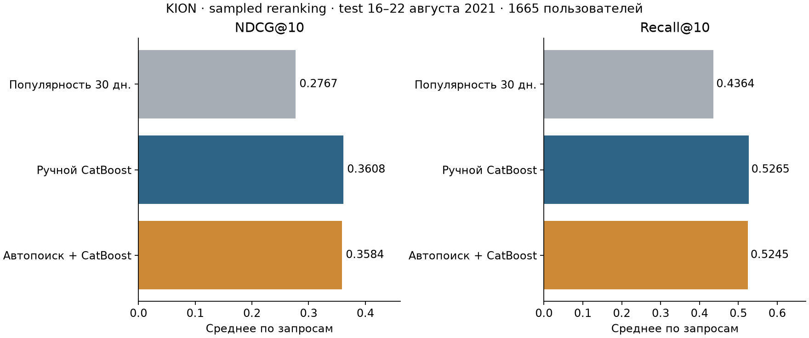

# Автопоиск признаков KION

[Текущая модель и проверенные улучшения](IMPROVEMENTS.md).

## Методы: от исходной реализации к текущей

**Изначально.** Проверяли автоматизацию ручных агрегатов при одном алгоритме ранжирования — CatBoostClassifier. Baseline: 34 признака активности пользователя, популярности объекта, прямой связи user–item и интереса к жанру/типу. Автопоиск перебирал пакеты окон 2/5/10/21/60 дней и затухания с half-life 3/10/21, до двух жадных добавлений по validation NDCG@10. Из 89 доступных признаков выбраны окна 2 и 21 день, итог — 50. На исходном test NDCG@10 0.360780 → 0.358450, интервал разности включает ноль: улучшение не подтверждено. Автопоиск реализован обычным алгоритмом, без ИИ-агента/генерации SQL.

**Что проверили затем.** Спектральные признаки графа; ItemKNN (сходство объектов по совместным просмотрам); расширенный набор `rich`; CatBoostRanker с YetiRank/NDCG@10. В одинаковом скрининге validation NDCG@10: baseline 0.361023, граф 0.368486, ItemKNN 0.382607, rich 0.384640, ranker 0.354487. Выиграл rich: 34 ручных + 6 графовых сигналов SVD32 + 3 ItemKNN + дополнительные окна 2/14, затухание 3/14 и доли интереса по всем жанрам; всего 73 признака. Это фиксированный расширенный набор, а не результат прежнего жадного автопоиска. EASE рассмотрен, но не запускался из-за плотной матрицы O(I²); GNN/трансформер отложены из-за бюджета и ограничений last-watch KION, их качество не измерялось.

**К чему пришли.** Грамматика окон сама по себе не обеспечила прирост на следующей неделе; сочетание агрегатов и сигналов сходства оказалось полезнее. После фиксации конфигураций сравнение повторили с переобучением на другой когорте из 5000 пользователей: NDCG@10 0.353255 → 0.372940, семейно скорректированный интервал Δ [0.008137; 0.031558]. На уже просмотренном старом test выполнена дополнительная проверка отсутствия регрессии: NDCG@10 0.360780 → 0.378699, Recall@10 0.526525 → 0.545733. Новая когорта относится к тому же периоду; перенос на другие периоды/промышленный retrieval не доказан.

**Что используется сейчас.** `predict.py` по умолчанию загружает **CatBoostClassifier с 73 признаками rich**, `results/upgrades/active.cbm`; depth=7, iterations=320, learning_rate=0.05, seed=2026. Источник конфигурации — [active_model.json](active_model.json). Для пары user–item признаки вычисляются из истории до cutoff, затем объекты сортируются по оценке. Это пакетный sampled reranking, не онлайн-сервис и не оценка CTR. Исходные manual/automatic и их таблицы ниже сохранены для воспроизводимости; они не описывают активную версию. Полные сравнения, условия внедрения и команды — [IMPROVEMENTS.md](IMPROVEMENTS.md).

**Исходный эксперимент:** CatBoost, 34 ручных → 50 отобранных признаков. Test NDCG@10 **0.360780 → 0.358450**, Δ **-0.002330 (-0.65%)**, парный 95% CI **[-0.006477; +0.001795]**. Парный интервал включает ноль: уверенного улучшения NDCG@10 на этом тесте не установлено.



## Данные и протокол

Прогноз просмотров следующей недели. [KION](https://github.com/irsafilo/KION_DATASET), commit `f69775be31fa5779907cf0a92ddedb70037fb5ae`: полный `data_original.zip` — **5,476,251 строк / 962,179 пользователей**, 2021-03-13–2021-08-22 (конечный год карточки ошибочен); сокращённый `interactions.csv.zip` — 1 594 787 строк. [Yambda](https://huggingface.co/datasets/yandex/yambda) рассмотрен, не использован.

`sort(unique user_id)` → `default_rng(42)` → **10,000 пользователей**, без возвращения/фильтра активности; все **55,922 строк**, включая однократных. Дубликаты источника/выборки: 0/0, повторы user–item: 0; user/item/date без пропусков, 828 пропусков watched_pct → 0.

KION хранит **последний просмотр пары**, условно `event_type=watch`: без показов/кликов/сырых повторов. Отсев будущих опубликованных строк проверен, но last-watch может скрывать ранние действия: точное прошлое сервиса не восстановить. Первый жанр, тип и возрастной рейтинг считаются постоянными (версий нет); демография/тексты не используются.

| cutoff | split | history_rows | queries | positives | excluded_cold_positives |
| --- | --- | --- | --- | --- | --- |
| 2021-06-14 | train | 20240 | 1418 | 3008 | 171 |
| 2021-06-21 | train | 23419 | 1265 | 2630 | 335 |
| 2021-06-28 | train | 26384 | 1610 | 3405 | 268 |
| 2021-07-05 | train | 30057 | 1316 | 2879 | 345 |
| 2021-07-12 | train | 33281 | 1320 | 3011 | 253 |
| 2021-07-19 | train | 36545 | 1369 | 3181 | 221 |
| 2021-07-26 | train | 39947 | 1481 | 3516 | 322 |
| 2021-08-02 | train | 43785 | 1477 | 3448 | 269 |
| 2021-08-09 | val | 47502 | 1568 | 3730 | 343 |
| 2021-08-16 | test | 51575 | 1665 | 4050 | 297 |

История `date<t`, label `[t,t+7 дней)`, окно `[t−w,t)`; дневная точность, без внутридневного порядка. Восемь train-недель → validation 9–15 августа → test 16–22 августа 2021; прошлые недели доступны поздним срезам, внутри недели признаки фиксированы.

Запрос=user×неделя с ≥1 положительным из прошлого каталога когорты. Кандидаты: все такие положительные + **99 уникальных неотмеченных** (50 равномерно, 49 по прошлой популярности^0.75). Label=1 — наличие строки, включая 0% watched_pct/total_dur; 0 — отсутствие строки, не отказ после показа. Просмотренное допускается в отрицательных: при уникальных парах прямая связь фильтрует его, что ограничивает перенос на повторное потребление.

**Sampled reranking:** будущие положительные включены принудительно, retrieval нет; оценка условна на активных запросах/сэмплированном каталоге. У методов одинаковы кандидаты/метки/история, метки и отклики других кандидатов вне признаков. Test: **1665 запросов / 168,885 пар / 4,050 положительных**; 297 будущих пар (6.83%) исключены как новые объекты. Cold user сохранены; неизвестная история — нули, давность 9999.

Общий train-бюджет: случайные **5000 полных запросов / 506,092 строк**, история не обрезана. Выбор только по validation → fit с добавлением всей validation, известной до test.

## Признаки и поиск

Manual: CatBoostClassifier/Logloss, без числовых ID; **34 признака**. Для user/item/user–item/user–genre/user–content_type — counts all/7/30 и давность; категории item, доли жанра/типа, тренды item, прошлый watched_pct user/item/user–genre. Сглаживание: знаменатель `count+1`, prior=0, не CTR. Точные формулы/исходный протокол: [DESIGN.md](DESIGN.md), [features.py](features.py). Ансамблей, retrieval и текстовых эмбеддингов нет.

Грамматика «связь×окно/затухание×агрегат»: окна **2/5/10/21/60** (counts/доли/тренды), half-life **3/10/21** (`sum(2**(-(t-date)/h))`), всего **89 признаков**. ≤2 жадных добавлений пакета, принять Δvalidation NDCG@10>0.00001; скрининг первой конфигурацией, затем общая сетка. Выбраны **window_2, window_21 → 50 признаков**. События/связи/операции/target задаёт человек; возможен пропуск совместно полезных пакетов, оптимальность не доказана.

Общая сетка `(depth,iterations,lr)`: **(5,180,0.08), (6,260,0.06), (7,320,0.05)**; seed42, L2=5, threads6, без early stopping; выбор по validation NDCG@10:

| name | columns | ndcg10 | recall10 | logloss | fit_seconds |
| --- | --- | --- | --- | --- | --- |
| manual_grid_0 | 34 | 0.370429 | 0.544464 | 0.092033 | 27.478616 |
| manual_grid_1 | 34 | 0.369152 | 0.549527 | 0.091966 | 60.648773 |
| manual_grid_2 | 34 | 0.373788 | 0.547909 | 0.091931 | 84.495342 |
| auto_grid_0 | 50 | 0.378716 | 0.554483 | 0.091953 | 27.938137 |
| auto_grid_1 | 50 | 0.375484 | 0.549462 | 0.092076 | 63.705110 |
| auto_grid_2 | 50 | 0.380520 | 0.550260 | 0.091861 | 89.010089 |

## Результаты и анализ

| model | features | logloss | roc_auc | ndcg10 | recall10 | fit_seconds | predict_seconds |
| --- | --- | --- | --- | --- | --- | --- | --- |
| manual | 34 | 0.094451 | 0.819672 | 0.360780 | 0.526525 | 107.495152 | 0.541562 |
| automatic | 50 | 0.094604 | 0.819455 | 0.358450 | 0.524527 | 112.346636 | 0.690970 |
| popularity30 | 1 | — | 0.761300 | 0.276660 | 0.436387 | 0.000000 | 0.000000 |

LogLoss/AUC — по строкам; NDCG/Recall@10 — равновесное среднее запросов. `DCG=sum(label/log2(rank+1))`, IDCG учитывает все положительные, ограничен top10; Recall=hits@10/**все положительные**. Равные score → меньший item_id. Популярность некалибрована (LogLoss=—); вероятности/LogLoss относятся к sampled-label, не CTR. Код: [experiment.py](experiment.py).

CI: 2000 парных bootstrap-повторов по 1665 пользователям, seed2026; условен на модели/неделе, без вариативности периодов/seed/поиска. Эквивалентность и неухудшение не доказаны (граница не задана). Лучший validation Δ **+0.006732** не перенёсся на test; шум/смена спроса — неразличимые здесь гипотезы.

Абляции: validation, первая конфигурация, без отдельного подбора; контроль `manual_grid_0`:

| name | columns | ndcg10 | recall10 | logloss |
| --- | --- | --- | --- | --- |
| manual_grid_0 | 34 | 0.370429 | 0.544464 | 0.092033 |
| all_generated | 89 | 0.374132 | 0.547719 | 0.092107 |
| manual_without_indirect | 19 | 0.359194 | 0.530403 | 0.093635 |
| manual_without_direct | 30 | 0.359892 | 0.534107 | 0.092833 |
| automatic_only | 58 | 0.377113 | 0.547154 | 0.092030 |

`without_indirect` удаляет user–genre/type, `without_direct` — user–item, `automatic_only` оставляет генерацию+3 категории. ΔNDCG: `all_generated`: +0.003703; `manual_without_indirect`: -0.011235; `manual_without_direct`: -0.010537; `automatic_only`: +0.006684. Косвенные связи отражают интересы, прямые — фильтр просмотренного. Отбор против всех 89: **+0.004584**; больше признаков не гарантирует прироста. Затухание не выбрано; half-life вне сетки не проверены. Вклады условны на бюджете, не причинны/универсальны.

Top10 importance автоматической модели (коррелирующие окна делят importance; это не прирост метрики):

| feature | importance |
| --- | --- |
| i_trend_21 | 9.555059 |
| i_count_30 | 9.404032 |
| i_count_all | 8.067064 |
| i_recency | 7.799558 |
| i_count_21 | 7.394373 |
| i_trend_30 | 5.911042 |
| ui_recency | 5.573258 |
| i_trend_7 | 4.511466 |
| i_count_7 | 3.340510 |
| i_count_2 | 3.193929 |

Полная траектория: [validation_trials.json](results/validation_trials.json). Описательные test-срезы, вне подбора:

| история | модель | запросы | NDCG@10 | Recall@10 |
| --- | --- | --- | --- | --- |
| Нет прошлых записей | manual | 538 | 0.426394 | 0.613311 |
| Нет прошлых записей | automatic | 538 | 0.421620 | 0.606987 |
| 1–4 прошлых записи | manual | 425 | 0.341727 | 0.526068 |
| 1–4 прошлых записи | automatic | 425 | 0.340187 | 0.533388 |
| 5+ прошлых записей | manual | 702 | 0.322028 | 0.460292 |
| 5+ прошлых записей | automatic | 702 | 0.321093 | 0.455966 |

Различия групп включают активность/состав объектов, не доказывают эффект длины истории; малые группы нестабильны.

## Затраты и границы

Wall-clock без сети/установки: подготовка **77.3 с**, 25 validation-fit **874.1 с**, весь experiment (поиск/финальные fit/прогнозы/метрики/bootstrap) **1127.2 с**; финальные fit/predict выше, пик памяти не измерен.

| этап | число fit | fit, секунд |
| --- | --- | --- |
| Ручная сетка | 3 | 172.622731 |
| Поиск пакетов | 15 | 417.690582 |
| Автоматическая сетка | 3 | 180.653336 |
| Диагностические абляции | 4 | 103.160826 |

Среда: Windows-10-10.0.19045-SP0, Python 3.11.9, CatBoost 1.2.8, NumPy 2.4.4, pandas 2.2.2, sklearn 1.9.1; 6 потоков/8 логических CPU. Общая сетка не уравнивает бюджеты: дополнительные fit поиска требуют амортизации. Подготовка ≈O(S·W·(E+Q)), матрица O(Q_total·F), без нагрузочной проверки; миллиардам событий нужны инкрементальные/потоковые окна и as-of joins. Популярность оценена по когорте.

Один период/seed, малая когорта/сетка, два шага поиска; CTR, удовлетворённость, полный каталог, KION SOTA и промышленный масштаб не проверены. Продолжение: rolling holdout/новые seed → полный каталог/фиксированный retrieval → поиск связей с авторами/всеми жанрами. Увиденный test не использовать для подбора.

## Запуск и проверки

Python 3.11, из проекта:

```powershell
python -m venv .venv
.venv\Scripts\Activate.ps1
python -m pip install -r requirements.txt
python run_all.py
```

Linux/macOS: `source .venv/bin/activate`. `run_all.py`: test_protocol → `prepare.py --users 10000 --seed 42` → validate → experiment → verify_results → make_report → test_upgrades → train_active. Архивы в data позволяют работать без сети, иначе скачивается фиксированный commit. Prepare восстанавливает удалённые матрицы/queries; сохранённый events.pkl позволяет сразу использовать predict. Experiment перезаписывает исходные результаты; платформы/версии могут дать малые численные отличия.

Проверены обучение/test, 2 исходных unit-теста, все метки/кандидаты/поля полной истории/SHA-256, counts одного кандидата каждого из 10 срезов: [protocol_validation.json](results/protocol_validation.json), [test_protocol.py](test_protocol.py). Независимые метрики из прогнозов: [result_validation.json](results/result_validation.json). Новые проверки/активная модель описаны в IMPROVEMENTS.

Код: prepare — данные/кандидаты; features — point-in-time грамматика; experiment — поиск/модели/метрики; validate/test — аудит; verify_results — независимые метрики; make_report — README/график. `results/`: таблицы, параметры/поиск, модели, importance, прогнозы, bootstrap; `data/source.json`/`results/data_audit.json`: источник/commit/хеши/объёмы. Поставка сохраняет исходные ZIP, выбранную историю/ID и результаты; пересчитываемые матрицы, queries и Python-кэши удалены.
