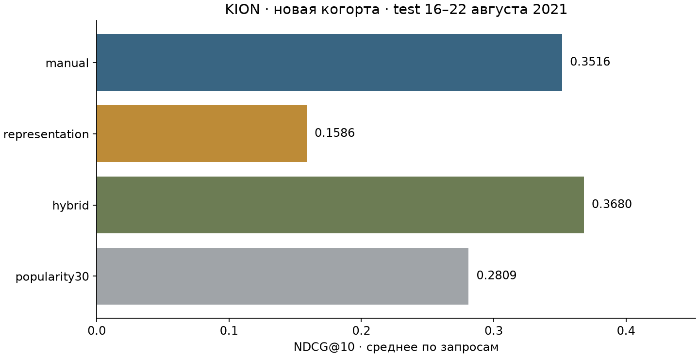

# Спектральные признаки KION

[Текущая модель и проверенные улучшения](IMPROVEMENTS.md).

## Методы: от исходной реализации к текущей

**Изначально.** Проверяли замену ручных агрегатов обучаемыми графовыми представлениями на отдельной когорте 5000 пользователей. Для каждого временного среза строили граф user–item с категориями жанра/типа; нормированную матрицу разлагали TruncatedSVD, проверяли размерности 16/32. Из item-эмбеддингов и истории пользователя получали 6 сигналов сходства, давности и холодного старта. Сравнивали один CatBoostClassifier на 34 ручных признаках (`manual`), только 6 графовых (`representation`) и их объединении из 40 (`hybrid`); дополнительно — популярность за 30 дней. Это спектральная модель с ручной компрессией истории, без GNN.

**Что показал исходный опыт.** Выбрана размерность SVD32. Test NDCG@10: manual 0.351639, representation 0.158649, hybrid 0.368044; прирост hybrid к manual +4.67%, парный 95% интервал Δ [0.007829; 0.024674]. Граф дополнил агрегаты, но не заменил их. Проверяли граф без категорий и cold/warm-срезы: категории полезны на validation; у пользователей без истории графовые сигналы одинаковы всем кандидатам, поэтому representation фактически сортирует их по item_id. Результаты не обобщаются на все графовые модели.

**Какие улучшения рассматривали.** К hybrid добавляли ItemKNN и набор rich из 73 признаков (граф32, ItemKNN, окна 2/14, затухание 3/14, все жанры); проверяли YetiRank/NDCG@10. Скрининг validation NDCG@10: baseline 0.360996, ItemKNN 0.357231, rich 0.371358, ranker 0.354294. После фиксации и переобучения на новой когорте rich дал 0.366861 → 0.377569, но семейно скорректированный интервал Δ [−0.000599; 0.021470] включает ноль: условие внедрения не выполнено. EASE рассмотрен без запуска из-за O(I²); GNN/трансформер отложены из-за бюджета и ограничений last-watch, их качество не измерялось.

**К чему пришли и что используется сейчас.** Основная модель остаётся **CatBoostClassifier hybrid: 34 ручных + 6 графовых сигналов SVD32**, `results/hybrid.cbm`; depth=7, iterations=260, learning_rate=0.05, seed=2026. `predict.py` по умолчанию использует её согласно [active_model.json](active_model.json); неподтверждённый rich не включён. В отдельном `--mode representation` внедрено переключение: пользователю без прошлой истории — прежний hybrid, остальным — исходная representation. На новой когорте NDCG@10 этого режима 0.166274 → 0.287421, семейный интервал Δ [0.100054; 0.143214]; на старом test 0.158649 → 0.282810. Это улучшение отдельного режима, не прирост основного hybrid. `--mode representation_raw` сохраняет исходную графовую модель без переключения.

Признаки и граф используют только историю до cutoff, далее ранжируются заданные кандидаты. Это пакетный sampled reranking; новая когорта проверяет другой состав пользователей того же периода, не перенос на новый период/сервис. Таблицы ниже относятся к исходному эксперименту; детали улучшений/проверок — [IMPROVEMENTS.md](IMPROVEMENTS.md). Метрики двух заданий напрямую несопоставимы из-за разных исходных когорт.

**Исходный эксперимент:** 5000 пользователей / 28260 строк, без пересечения с 10 000 пользователями первой работы. CatBoost: manual34 / representation6 / hybrid40.

| model | fit_seconds | predict_seconds | logloss | roc_auc | ndcg10 | recall10 | queries |
| --- | --- | --- | --- | --- | --- | --- | --- |
| manual | 68.043373 | 0.156253 | 0.096762 | 0.809687 | 0.351639 | 0.495455 | 830 |
| representation | 4.564269 | 0.013090 | 0.107335 | 0.687318 | 0.158649 | 0.257847 | 830 |
| hybrid | 70.050177 | 0.152920 | 0.094948 | 0.819965 | 0.368044 | 0.512663 | 830 |
| popularity30 | 0.000000 | 0.000000 | — | 0.744927 | 0.280945 | 0.430595 | 830 |

ΔNDCG@10 к manual: парный percentile bootstrap по пользователям, **95%, 2000 повторов, seed2026**:

| model | delta | lo95 | hi95 |
| --- | --- | --- | --- |
| representation | -0.192990 | -0.217953 | -0.166263 |
| hybrid | 0.016404 | 0.007829 | 0.024674 |

Гибрид **+4.67%**: граф дополняет, но не заменяет агрегаты. representation: отрицательный интервал разности NDCG@10; hybrid: положительный интервал разности NDCG@10. Интервалы условны на периоде/моделях/seed, без вариативности поиска/когорт/недель; обобщение не гарантировано, неухудшение без заданной границы не доказано.



## Данные и протокол

[KION](https://github.com/irsafilo/KION_DATASET), commit `f69775be31fa5779907cf0a92ddedb70037fb5ae`: полный `data_original.zip`, **5476251 строк / 962179 пользователей**, март–август 2021; сокращённый interactions.zip не используется. SHA-256 `50fc5b7db78cbda4c3d0ee5bb5bea4c416cff41e8af58aab0b661d0d3e9dfa9b`. Исключены `excluded_previous_users.npy` → sort(ID) → `default_rng(2026)` → 5000 без возвращения/фильтра активности. Все исходные поля истории независимо сверены, пересечение=0; с первой работой общие период/каталог, независимость только пользователей.

Last-watch пары (`event_type=watch`), повторов 0; без показов/кликов/сырой последовательности. Отсев будущих опубликованных строк проверен, но последние даты скрывают ранние действия: точное прошлое сервиса не восстановить. Метаданные постоянны без версий: первый жанр/тип — графу, плюс возрастной рейтинг — manual/hybrid; демография/тексты не используются.

| cutoff | split | history | queries | rows | positives | excluded_cold |
| --- | --- | --- | --- | --- | --- | --- |
| 2021-06-28 | train | 13796 | 826 | 83399 | 1625 | 171 |
| 2021-07-05 | train | 15592 | 643 | 65032 | 1375 | 270 |
| 2021-07-12 | train | 17237 | 653 | 66108 | 1461 | 208 |
| 2021-07-19 | train | 18906 | 606 | 61357 | 1363 | 191 |
| 2021-07-26 | train | 20460 | 692 | 70023 | 1515 | 231 |
| 2021-08-02 | train | 22206 | 716 | 72439 | 1555 | 206 |
| 2021-08-09 | val | 23967 | 757 | 76735 | 1792 | 220 |
| 2021-08-16 | test | 25979 | 830 | 84207 | 2037 | 244 |

История `date<t`, label `[t,t+7 дней)`, окно `[t−w,t)`, дневная точность без внутридневного порядка. Шесть train-недель → validation 9–15 августа → test 16–22 августа 2021; прошлые недели доступны поздним срезам, внутри недели признаки фиксированы.

Запрос=user×неделя с ≥1 положительным из прошлого каталога когорты. Все такие положительные + **99 уникальных неотмеченных** (50 равномерно, 49 по прошлой популярности^0.75). Label=1 — строка, включая 0% watched_pct/total_dur; 0 — нет строки, не отказ. Cold item исключены (таблица), cold user сохранены. Просмотренное допускается в отрицательных: при уникальных парах прямая связь фильтрует его, не моделирует повторы.

**Sampled reranking:** положительные включены принудительно, запросы активные; абсолютные метрики не описывают базу/каталог/сложный retrieval. У методов одинаковы кандидаты/метки/история, labels вне признаков. Все train-запросы → выбор только на validation → fit train+validation, известной до test.

## Признаки и подбор

Manual: CatBoostClassifier/Logloss, без числовых ID, **34 признака**. Категории item; counts all/7/30 и давность user/item/user–item/user–genre/user–type (9999 без истории); доли `count_relation/(count_user+1)`, тренды `count_window/(count_all+1)`, watched_pct user/item/user–genre `sum(fillna(pct,0))/(count+1)`. Prior=0, не CTR: [features.py](features.py).

Разреженная A каждого среза: строки user/категории, столбцы прошлых item; user–item вес1, item–genre/type по одному ребру веса0.5. Нормировка взвешенными степенями `D_row^(-1/2) A D_col^(-1/2)`. [TruncatedSVD](https://scikit-learn.org/stable/modules/generated/sklearn.decomposition.TruncatedSVD.html): randomized, n_iter7, seed2026, d=16/32; L2-нормированные строки V — item-эмбеддинги. Обучается спектр без labels, не GNN.

L2-профили — суммы всей истории, равномерная и `2^(-age_days/7)`. **6 сигналов:** косинусы с обоими профилями; max-косинус с последними3 item (равные даты → item_id); `log(1+sum(weights))`; евклидово расстояние профилей; cold-индикатор (остальные cold-сигналы=0). Масса/cold, связи, нормировка, half-life7 и последние3 заданы вручную. Сходства/расстояния инвариантны общему ортогональному повороту; координаты разных срезов не сравниваются. Fit строго прошлого, одна доступная история всем. graph16/32 с категориями; no_categories — диагностические16 без них. Representation=6, hybrid=6+34, общий CatBoost.

Сетка `(depth,iterations,lr)`: **(5,180,0.08), (7,260,0.05)**; L2=5, threads6, seed2026, без early stopping. Manual: обе; representation/hybrid: graph16/32 при первой, победитель validation NDCG@10 также при второй. no_categories вне выбора; бюджет альтернатив больше. Зафиксировано: `{"graph": {"representation": "graph32", "hybrid": "graph32"}, "parameters": {"manual": {"depth": 7, "iterations": 260, "learning_rate": 0.05}, "representation": {"depth": 5, "iterations": 180, "learning_rate": 0.08}, "hybrid": {"depth": 7, "iterations": 260, "learning_rate": 0.05}}}`.

| name | features | ndcg10 | recall10 | logloss | fit_seconds |
| --- | --- | --- | --- | --- | --- |
| manual_0 | 34 | 0.353144 | 0.522557 | 0.094368 | 23.934116 |
| manual_1 | 34 | 0.354091 | 0.515925 | 0.094536 | 59.605421 |
| representation_graph16 | 6 | 0.143597 | 0.228732 | 0.106296 | 3.967739 |
| representation_graph32 | 6 | 0.158931 | 0.250419 | 0.104935 | 3.917845 |
| representation_no_categories | 6 | 0.114482 | 0.181013 | 0.108393 | 3.932630 |
| representation_grid1 | 6 | 0.157814 | 0.245176 | 0.105020 | 10.761194 |
| hybrid_graph16 | 40 | 0.358782 | 0.529201 | 0.093350 | 23.618600 |
| hybrid_graph32 | 40 | 0.361925 | 0.528930 | 0.092983 | 23.912781 |
| hybrid_no_categories | 40 | 0.346412 | 0.510141 | 0.094331 | 23.579357 |
| hybrid_grid1 | 40 | 0.366733 | 0.532198 | 0.092881 | 61.825921 |

Абляция категорий: d16, первая конфигурация:

| name | features | ndcg10 | recall10 | logloss |
| --- | --- | --- | --- | --- |
| representation_graph16 | 6 | 0.143597 | 0.228732 | 0.106296 |
| representation_no_categories | 6 | 0.114482 | 0.181013 | 0.108393 |
| hybrid_graph16 | 40 | 0.358782 | 0.529201 | 0.093350 |
| hybrid_no_categories | 40 | 0.346412 | 0.510141 | 0.094331 |

Δvalidation NDCG@10 категорий **+0.029115/+0.012370** (representation/hybrid): меняется весь спектр, не один жанр/тип; вклад условен на seed/бюджете, не причинен. Компрессия может терять counts/временные масштабы; короткая история/популярность/геометрия — гипотезы, один holdout их не различает.

## Диагностика и метрики

Test-срезы, вне подбора:

| group | model | queries | ndcg10 | recall10 |
| --- | --- | --- | --- | --- |
| cold | manual | 271 | 0.422330 | 0.588914 |
| cold | representation | 271 | 0.045006 | 0.080259 |
| cold | hybrid | 271 | 0.425278 | 0.597525 |
| warm | manual | 559 | 0.317369 | 0.450147 |
| warm | representation | 559 | 0.213742 | 0.343941 |
| warm | hybrid | 559 | 0.340296 | 0.471523 |

Cold: графовые сигналы одинаковы кандидатам → item_id tie-break; manual/hybrid сохраняют популярность/категории item. Warm-компрессия также может терять статистику; срезы не причинны, провал не обобщается на все графовые модели.

Top8 importance hybrid (корреляции делят importance, она не равна приросту качества; полные `*_importance.csv`):

| feature | importance |
| --- | --- |
| i_count_30 | 11.740222 |
| i_recency | 9.675031 |
| i_trend_7 | 7.069780 |
| i_count_all | 6.828849 |
| i_count_7 | 6.746171 |
| i_trend_30 | 6.535312 |
| ui_recency | 5.321055 |
| g_cos_7 | 4.898318 |

LogLoss/AUC по строкам, NDCG/Recall@10 — равновесное среднее запросов. `DCG=sum(label/log2(rank+1))`, IDCG по всем положительным, ограничен top10; Recall=hits@10/**все положительные**. Равные score → меньший item_id. Вероятности/LogLoss относятся к sampled-label, не CTR; популярность некалибрована (LogLoss=—).

## Затраты и границы

Wall-clock без сети/установки: подготовка **95.9 с**, включая 24 графа/признака (3×8, **66.0 с**); experiment **387.9 с**, validation-fit **239.1 с**; финальные fit/predict выше. Графовые fit/predict входят в подготовку, не CatBoost; пик памяти не измерен. Windows-10-10.0.19045-SP0, Python3.11, `requirements.txt`, threads6.

Память A: O(nnz(A)), эмбеддинги O((U+I)·d); SVD≈O(nnz(A)·d·итерации), без ортогонализации/oversampling; пары O(Q·d) плюс профили/последние3. Нагрузочных проверок нет; миллиардам событий нужны инкрементальные профили/потоковые окна/распределённый fit/кэш.

Один seed/период, малая когорта/сетка/d, фиксированная компрессия, общая эпоха первой работы; ограничения last-watch/метаданных/sampled описаны выше. CTR, удовлетворённость, полный retrieval и KION SOTA не проверены. Продолжение: rolling holdout/новые seed → полный каталог/фиксированный retrieval → GNN/обучаемая история с тем же протоколом. Увиденный test не использовать для подбора.

## Запуск и проверки

```powershell
python -m venv .venv
.venv\Scripts\Activate.ps1
python -m pip install -r requirements.txt
python run_all.py
```

Linux/macOS: `source .venv/bin/activate`. run_all: test_protocol → prepare → validate → experiment → validate → report → test_upgrades → train_active. Архив в data позволяет работать без сети, иначе скачивается фиксированный commit; exclusion-ID сохранены. Prepare восстанавливает удалённые матрицы/queries; events.pkl оставлен для predict. Experiment перезаписывает исходные результаты.

Проверены manual/graph future-invariance (с/без категорий, cold user), полная история/непересечение когорт, все метки/кандидаты, независимые test NDCG/Recall из прогнозов: [validation_checks.json](results/validation_checks.json), `{"full_history_verified": true, "previous_users_overlap": 0, "all_labels_verified": true, "negatives_per_query": 99, "rows": 579300, "test_ranking_independently_verified": true}`.

Полный повтор run_all: выбор идентичен, validation/test-метрики и все test-прогнозы совпали при atol=1e-12. Исходные замеры сохранены; [итог](verification/reproduction.json) и лог в [verification/](verification/). Дубли результатов удалены после сравнения.

Код: prepare — данные/выборка/срезы; features — manual; graph — спектр/компрессия; experiment — подбор/модели; metrics — fit/метрики; validate/test — аудит; report — README/график. results: подбор/параметры/test/прогнозы/интервалы/модели/importance/аудит/время. Сохранены исходный ZIP, история/ID и результаты; матрицы, queries, Python-кэши и дубли повторного прогона удалены.
